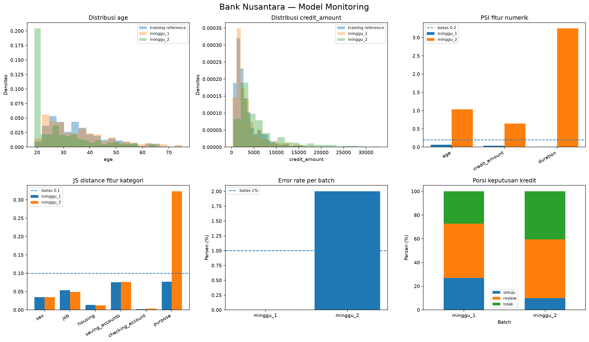

# Mini Project 7 — Sistem Kredit Bank Nusantara

**Nama:** [Isi nama lengkap]  
**Program:** Full Stack Bangalore — Mini Project 7, Pertemuan 26–28  
**Studi kasus:** Bank Nusantara (fiktif)  
**Status:** Implementasi Bagian A, B, C telah dijalankan lokal; beberapa bukti final masih harus dilengkapi.

## Gambaran sistem

Proyek ini menggabungkan tiga alur. **Bagian A (RAG)** mencari aturan kredit dalam delapan dokumen kebijakan dengan dense retrieval, BM25, RRF, dan cross-encoder reranking. **Bagian B (MLOps)** melatih tiga kandidat model credit risk, mengevaluasi quality gate, serta mendaftarkan model terpilih melalui MLflow. **Bagian C (monitoring)** memuat champion model, mensimulasikan dua minggu request, dan mendeteksi perubahan distribusi maupun masalah operasional.

Bagian A independen. Bagian C bergantung pada model `models:/credit-risk@champion` yang dihasilkan Bagian B.

## Setup dan cara menjalankan

Gunakan Python 3.10–3.13 dari folder root proyek. Contoh CMD Windows:

```cmd
python -m venv .venv
.venv\Scripts\activate.bat
python -m pip install -r requirements.txt
python -m pytest -q
python src/rag_eval.py
python src/pipeline.py --reason "eksperimen pertama"
python src/quality_gate.py
python src/simulate.py
python src/monitor.py
mlflow ui --backend-store-uri sqlite:///mlflow.db
```

Dataset harus tersedia di `data/credit/german_credit_data.csv`. Pada pengujian lokal terakhir, **8 dari 8 unit test lulus**. File database dan artifact MLflow sengaja tidak dikomit; model champion perlu dibuat ulang saat *clean clone* melalui pipeline. Pengunduhan model Hugging Face pada pemakaian pertama membutuhkan koneksi internet.

## Bagian A — RAG Engineering

Dokumen kebijakan berjumlah delapan dan dipisah berdasarkan pasal menjadi **24 chunk**. Embedding model: `paraphrase-multilingual-MiniLM-L12-v2`, reranker: `mmarco-mMiniLMv2-L12-H384-v1`.

| Mode | Hit@3 | Citation accuracy | Fallback accuracy | Rata-rata latency |
|---|---:|---:|---:|---:|
| dense | 91,67% | 83,33% | 100% | 28,22 ms |
| bm25 | 83,33% | 58,33% | 100% | 28,10 ms |
| hybrid | 91,67% | 91,67% | 100% | 26,88 ms |
| **hybrid_rerank** | **100%** | **100%** | **100%** | **128,91 ms** |

Evaluasi menggunakan **12 pertanyaan dalam topik dan 3 di luar topik**, dengan output mentah di `reports/rag_eval_detail.csv` serta rekap di `reports/rag_eval_summary.csv`.

**Pemilihan metode.** Saya memilih `hybrid_rerank` karena semua pertanyaan dalam topik menemukan dokumen yang benar di tiga besar dan sitasi peringkat pertama tepat pada evaluasi ini. Trade-off-nya, latency rata-rata 128,91 ms dibanding 26,88 ms pada hybrid tanpa reranking. Karena pertanyaan berkaitan dengan kebijakan kredit, ketepatan sumber menjadi pertimbangan utama; tetapi pengujian beban dan pertanyaan baru masih diperlukan.

**Fallback threshold.** Nilai dipertahankan **0,35**. Skor tertinggi dari tiga pertanyaan di luar topik adalah **0,216697**, sedangkan skor terendah pertanyaan dalam topik adalah **0,484121**. Seluruh sampel evaluasi terpisah dengan ambang tersebut. Skor cosine bukan probabilitas terkalibrasi bahwa jawaban benar, dan pemisahan pada 15 pertanyaan tidak menjamin hasil yang sama pada pertanyaan baru.

## Bagian B — MLOps Credit Risk

Dataset German Credit memiliki 1.000 baris, sembilan fitur, dan target `bad`: 700 label `good` (0), 300 label `bad` (1). Split stratified 70/30 dengan `random_state=42`: 700 data train dan 300 data test. Dua kolom rekening yang kosong diisi `unknown`, dan kategori `job` diperlakukan sebagai kategori. Nilai `data_version` dari SHA-256 (12 karakter awal): **`42be3b82a2e5`**.

| Model | ROC-AUC | Recall bad | Precision bad | F1 bad | Quality gate |
|---|---:|---:|---:|---:|---|
| Logistic Regression | 0,7592 | 0,7222 | 0,5000 | 0,5909 | Lulus |
| **Random Forest** | **0,7629** | **0,7222** | 0,4887 | 0,5830 | **Lulus** |
| Gradient Boosting | 0,7670 | 0,3556 | 0,5517 | 0,4324 | Gagal |

Quality gate meminta **ROC-AUC ≥ 0,70 dan recall bad ≥ 0,50**. Gradient Boosting memang memiliki AUC paling tinggi, tetapi hanya menangkap sekitar 32 dari 90 pemohon bad di test set; karena itu gagal gate. Random Forest dipilih karena AUC-nya paling tinggi di antara kandidat yang lolos kedua gate. Selisih AUC Random Forest dan Logistic Regression kecil dan belum diuji signifikansinya.

Pipeline lokal sudah melatih ketiga kandidat dan berhasil mendaftarkan **`credit-risk` versi 1** serta mempromosikan alias **`champion`** ke versi tersebut. URI model: `models:/credit-risk@champion`. Perintah `python src/quality_gate.py` menghasilkan `QUALITY GATE: LULUS`, dan `reports/best_metrics.json` terbentuk dari pipeline.

**Bukti MLflow:**

- [ ] Simpan screenshot perbandingan run ke `screenshots/mlflow_runs.png`.
- [ ] Simpan screenshot registry dan alias champion ke `screenshots/mlflow_registry.png`.

**Bukti negative test gate (wajib):** [Belum dijalankan / tempel output eksperimen ROC-AUC minimum 0,95. Pastikan nilai dikembalikan ke 0,70 setelah eksperimen.]

**Bukti idempotensi promosi (wajib):** [Belum diuji / jalankan pipeline ulang tanpa perubahan data atau konfigurasi; tulis apakah alias champion tetap mengarah ke versi yang sama, dan alasan model baru tidak dipromosikan.]

## Bagian C — Model Monitoring

Simulasi melayani **600 request**: 300 minggu pertama dan 300 minggu kedua. Minggu pertama: 300 `ok`, 0 `error`; minggu kedua: 294 `ok`, 6 `error` (2%).

| Metrik | Minggu 1 | Minggu 2 |
|---|---:|---:|
| Requests | 300 | 300 |
| Error rate | 0% | 2% |
| p50 latency | 64,75 ms | 101,90 ms |
| p95 latency | 78,71 ms | 121,04 ms |
| Throughput | 15,48 rps | 10,07 rps |
| Rata-rata `prob_bad` | 0,4524 | 0,5307 |
| Proporsi `tolak` | 27,33% | 40,48% |
| ROC-AUC | 0,7629 | 0,7355 |

**Fitur yang drift pada minggu kedua:** `age` (PSI **1,0329**), `credit_amount` (PSI **0,6418**), `duration` (PSI **3,2464**), dan `purpose` (Jensen-Shannon distance **0,3231**). Semua melampaui ambang yang ditetapkan (PSI > 0,2; JS > 0,1). Tabel terperinci, termasuk KS, ada di `reports/drift_metrics.csv`.

**Alert aktif:** error rate minggu kedua **2% > 1%**, serta drift pada empat fitur di atas. Tidak muncul alert pada minggu pertama. Latency p95 kedua minggu masih di bawah 200 ms. AUC minggu kedua turun dari 0,7629 menjadi **0,7355**, tetapi **belum di bawah 0,70**.

**Apakah retrain sekarang?** Belum otomatis. Nilai `"retrain": true` di `reports/retrain_trigger.json` ditafsirkan sebagai pemicu investigasi dan evaluasi kandidat retraining, bukan perintah langsung promosi model. Pertama, saya akan memeriksa enam request invalid, memvalidasi perubahan input dan data pipeline, lalu mengumpulkan data baru dengan label `good/bad` yang dapat dipercaya. Setelah cukup label tersedia, barulah kandidat retraining diuji dengan pemisahan yang benar, quality gate, dan perbandingan terhadap champion. Rollback dipertimbangkan jika masalah terkonfirmasi pada model/versi yang baru dipromosikan dan versi sebelumnya terbukti lebih aman.



Laporan tambahan: `reports/monitoring_report.md`, `reports/drift_metrics.csv`, `reports/retrain_trigger.json`. Log request dan label simulasi ada di `logs/predictions.csv` dan `logs/labels.csv`.

## Keterbatasan dan eksperimen berikutnya

1. Evaluasi RAG hanya 15 pertanyaan; Hit@3 dan citation accuracy 100% pada sampel ini belum menjamin akurasi pada variasi pertanyaan nyata. Perlu pengujian out-of-distribution, variasi parafrase, dan load test untuk latency.
2. Seleksi kandidat kredit menggunakan metrik pada test set yang sama. Angka yang dilaporkan dapat menjadi optimistis setelah pemilihan; evaluasi final sebaiknya memakai holdout terpisah atau nested validation. Probabilitas model juga belum dikalibrasi dan belum ada audit fairness terhadap subkelompok pemohon.
3. Simulasi minggu kedua memang sengaja membuat drift dan menyediakan label. Pada operasional kredit nyata label keberhasilan pembayaran biasanya terlambat, sehingga AUC tidak selalu bisa dipantau secara langsung.

**Eksperimen berikutnya:** Kumpulkan label baru yang layak, latih ulang kandidat pada data yang relevan, bandingkan AUC/recall, kalibrasi probabilitas, dan uji dampak keputusan kredit sebelum mempertimbangkan penggantian champion.

## Bukti yang masih perlu diselesaikan sebelum submit

- [ ] Screenshot `screenshots/mlflow_runs.png` dan `screenshots/mlflow_registry.png` benar-benar tersimpan.
- [ ] Negative test quality gate 0,95 dilakukan dan dikembalikan ke 0,70; catat output gagal.
- [ ] Uji pipeline kedua tanpa perubahan, pastikan champion lama tidak terganti jika kandidat tidak lebih baik.
- [ ] Periksa `SOP.md` berisi prosedur konkret, panjang maksimal satu halaman.
- [ ] Verifikasi `git status`, `git check-ignore` untuk `.venv`, MLflow DB, dan artefak besar.
- [ ] Verifikasi repository GitHub dan instruksi clean clone; kirim link ke mentor.
