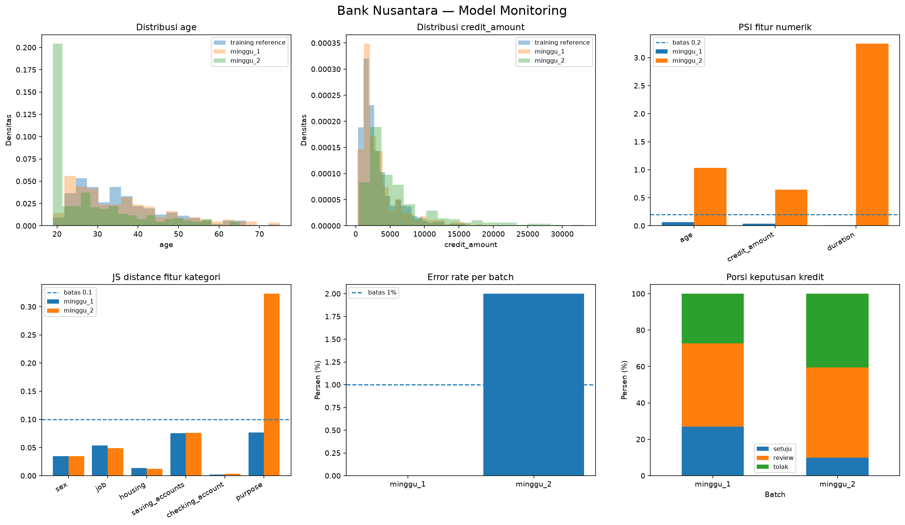

# Monitoring Model Credit Risk — Bank Nusantara

Referensi: 700 data training; batch simulasi minggu_1 dan minggu_2.
Label simulasi disimpan terpisah; label kredit riil umumnya baru tersedia belakangan.

## Metrik Operasional dan Kualitas
| batch    |   requests |   error_rate |   p50_latency_ms |   p95_latency_ms |   throughput_rps |   mean_prob_bad |   share_tolak |    auc |
|:---------|-----------:|-------------:|-----------------:|-----------------:|-----------------:|----------------:|--------------:|-------:|
| minggu_1 |        300 |         0    |          64.7519 |          78.7139 |          15.4759 |          0.4524 |        0.2733 | 0.7629 |
| minggu_2 |        300 |         0.02 |         101.897  |         121.042  |          10.0678 |          0.5307 |        0.4048 | 0.7355 |

## Drift Fitur (PSI / KS / JS)
| batch    | feature          | type     |      psi |   ks_stat |     ks_p |       js | drift   |
|:---------|:-----------------|:---------|---------:|----------:|---------:|---------:|:--------|
| minggu_1 | age              | numerik  |   0.0641 |    0.0681 |   0.2727 | nan      | False   |
| minggu_1 | credit_amount    | numerik  |   0.038  |    0.041  |   0.8591 | nan      | False   |
| minggu_1 | duration         | numerik  |   0.0123 |    0.0414 |   0.8497 | nan      | False   |
| minggu_1 | sex              | kategori | nan      |  nan      | nan      |   0.0348 | False   |
| minggu_1 | job              | kategori | nan      |  nan      | nan      |   0.0538 | False   |
| minggu_1 | housing          | kategori | nan      |  nan      | nan      |   0.0135 | False   |
| minggu_1 | saving_accounts  | kategori | nan      |  nan      | nan      |   0.0752 | False   |
| minggu_1 | checking_account | kategori | nan      |  nan      | nan      |   0.0017 | False   |
| minggu_1 | purpose          | kategori | nan      |  nan      | nan      |   0.077  | False   |
| minggu_2 | age              | numerik  |   1.0329 |    0.4477 |   0      | nan      | True    |
| minggu_2 | credit_amount    | numerik  |   0.6418 |    0.3214 |   0      | nan      | True    |
| minggu_2 | duration         | numerik  |   3.2464 |    0.4689 |   0      | nan      | True    |
| minggu_2 | sex              | kategori | nan      |  nan      | nan      |   0.0348 | False   |
| minggu_2 | job              | kategori | nan      |  nan      | nan      |   0.0492 | False   |
| minggu_2 | housing          | kategori | nan      |  nan      | nan      |   0.0122 | False   |
| minggu_2 | saving_accounts  | kategori | nan      |  nan      | nan      |   0.0763 | False   |
| minggu_2 | checking_account | kategori | nan      |  nan      | nan      |   0.0035 | False   |
| minggu_2 | purpose          | kategori | nan      |  nan      | nan      |   0.3231 | True    |

## Alert
- minggu_2: error rate 2.0% > 1%
- minggu_2: drift pada age, credit_amount, duration, purpose

## Contoh Input Gagal
| request_id   | batch    | error                                         |
|:-------------|:---------|:----------------------------------------------|
| 2-0010       | minggu_2 | field kosong: ['age']                         |
| 2-0020       | minggu_2 | credit_amount harus angka positif, dapat -500 |
| 2-0030       | minggu_2 | duration harus angka positif, dapat dua belas |
| 2-0040       | minggu_2 | field kosong: ['purpose']                     |
| 2-0110       | minggu_2 | field kosong: ['age']                         |
| 2-0120       | minggu_2 | credit_amount harus angka positif, dapat -500 |

## Interpretasi dan Tindak Lanjut
Drift menunjukkan perubahan sebaran, bukan otomatis penurunan akurasi. 
Periksa terlebih dahulu integritas input, kesesuaian sampel, besaran drift, ketersediaan label, lalu bandingkan kandidat retrain dengan champion melalui quality gate.

